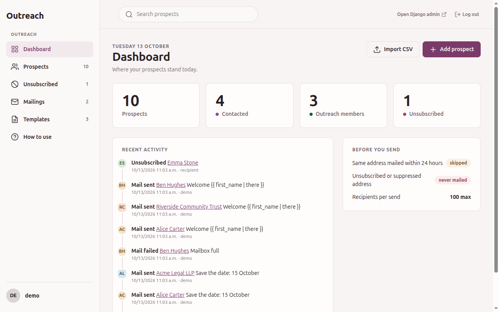
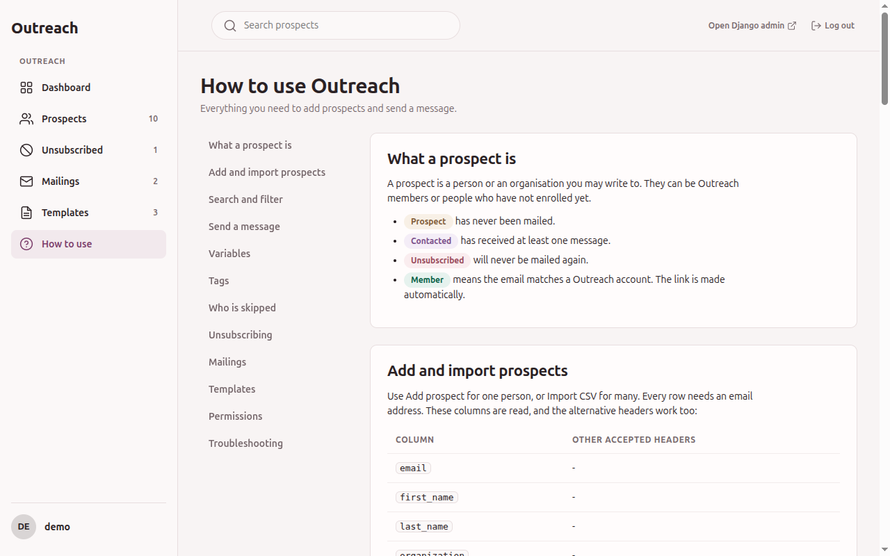

# User guide

This guide is for the staff who use the Outreach site to keep a list of prospects and mail them.
It assumes a developer has already installed the app, see {doc}`../installation`.

## Signing in

The site lives under the prefix chosen by the developer, for example `/outreach/`. It has its
own login page, separate from Django's `/admin/`. You need an active staff account with the
`outreach.view_prospect` permission. What you can do after signing in depends on the other
permissions your group holds, see {ref}`permissions`.

## The sidebar



| Entry | What it holds | Needs |
|---|---|---|
| Dashboard | Counts of prospects, contacted, members and unsubscribed, recent activity, and the sending limits | `view_prospect` |
| Prospects | The prospect list, with search and filters | `view_prospect` |
| Unsubscribed | The prospect list filtered on unsubscribed | `view_prospect` |
| Mailings | The history of every send | `view_mailing` |
| Templates | Saved subject and body pairs | `view_emailtemplate` |
| How to use | A help page with the variables, tags and import columns of your installation | `view_prospect` |

An entry you may not use is hidden. If your developer left the default Django admin mounted, an
*Open Django admin* link appears in the top bar.

## The help page

*How to use* lists the variables, the computed tags (with an example of each) and the import
columns, including any alias the developer configured. It is generated from the running
installation, so it is always correct for your site. It exists in English and French.



```{toctree}
:maxdepth: 1

prospects
sending-mail
email-templates
mailings
unsubscribe
```
