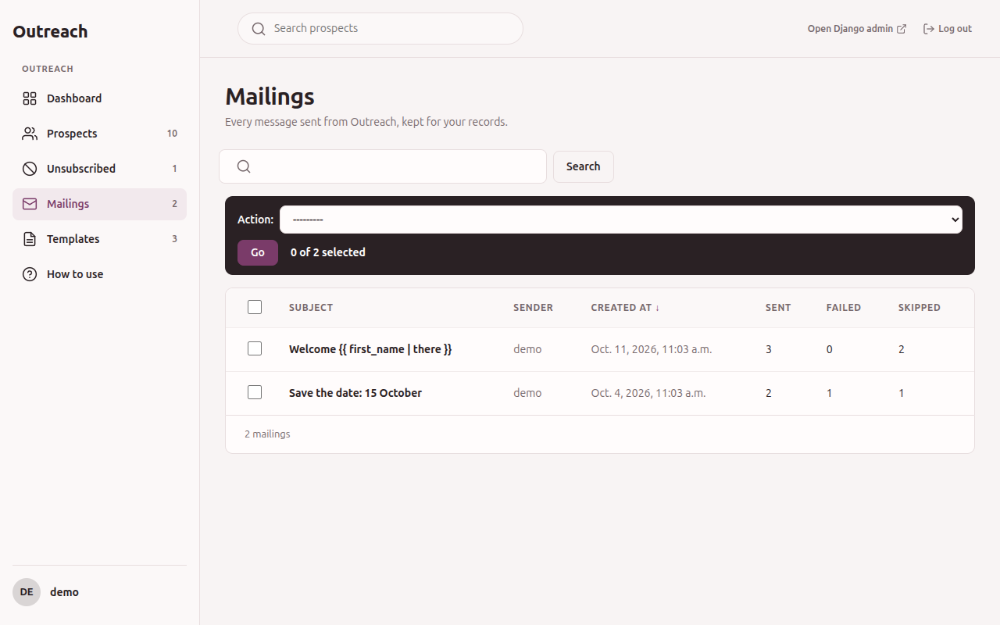
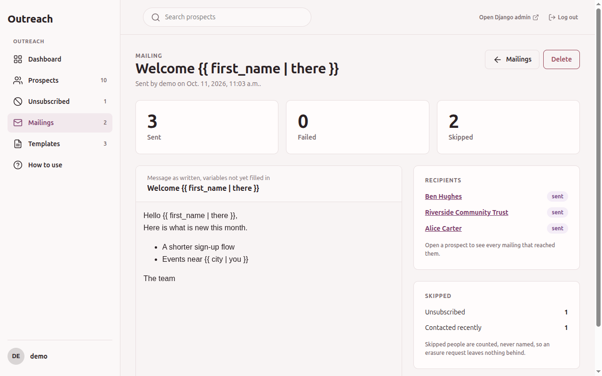

# Mailings

A mailing is the record of one send that had at least one recipient. *Mailings* in the sidebar
needs `outreach.view_mailing`.

## The list

Each row shows the subject, who sent it, the date, and the counts of sent, failed and skipped
recipients. You can search the subject and the sender.

## The detail page

Open a mailing to see:

- The subject and message exactly as they were sent (variables not replaced), in a frame cut off
  from the rest of the page.
- The recipients who were sent the mail or failed, taken from the events recorded for the
  mailing. A prospect that was deleted since no longer appears.
- The number of skipped recipients per reason: unsubscribed, suppressed, contacted recently, over
  the send limit, not a member.
- Whether it was a newsletter or a notice, and its header text.

Skipped people are stored as counts, never as names. A mailing outlives the prospects it was sent
to, and it must not keep data about someone who asked for erasure.

## What you can not do

Mailings can not be added or changed, only read and deleted. Deleting needs
`outreach.delete_mailing` and removes the log entry, not the mails.
