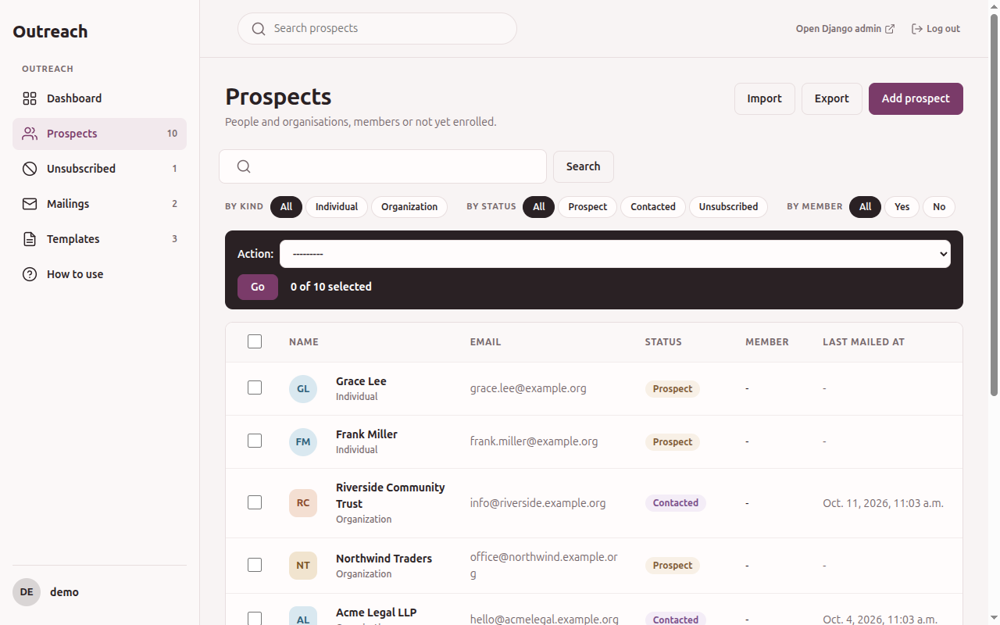

# Prospects

A prospect is a person or an organisation that may be mailed.

## Statuses

| Status | Meaning |
|---|---|
| Prospect | Never mailed |
| Contacted | Mailed at least once. Set by a send, never by hand |
| Unsubscribed | Asked not to be mailed. Final, see {doc}`unsubscribe` |

A *member* is a prospect linked to a user account of your site. Members appear with their own
filter and count on the dashboard.

## Finding prospects

The list shows the name, email, status, whether the prospect is a member and the date of the last
mail. Search covers the email, first name, last name and organisation. Filters cover the kind
(individual or organization), the status, membership and audience, see {doc}`audiences`.

## Adding and editing a prospect

Use *Add prospect*. The form holds the email, the kind, first and last name, organization, city
and country.

- The email is stored in lower case.
- The email can not be changed once the prospect exists. A changed address would carry the
  consent given by one person to another one. To use another address, add a new prospect.
- The status, the last mailed date and the linked user are shown but read-only. They change
  through sending, unsubscribing and linking.
- Adding an address that is on the suppression list creates a prospect that is already
  unsubscribed.

Each prospect page ends with its history: added, imported, edited, linked, mail sent, mail failed
and unsubscribed, with who did it and, for a mail, its subject. You need `add_prospect` to add a
prospect, `change_prospect` to edit one and `delete_prospect` to delete one.

## Importing a file

*Import CSV* on the dashboard takes a CSV file in UTF-8 with a header row. It needs
`add_prospect`. You first see a preview of the new and the skipped rows, then confirm.

- The columns are `email`, `first_name`, `last_name`, `organization`, `city`, `country` and
  `kind`. Headers are lower-cased and stripped, and your developer may have added aliases. The
  *How to use* page lists what your site accepts.
- A row whose email already exists is skipped, never updated.
- One invalid row stops the whole file. Nothing is imported until every row is valid.
- A blank `kind` means individual.
- An address on the suppression list is imported as unsubscribed.
- A repeated email in the same file is imported once.
- A file over the row or size limit is rejected.

## Exporting

Tick the prospects, or use *Select all* to take every match of the current filters, then choose
*Export the selected prospects as CSV* in the *Action* menu. It needs `view_prospect`. The file
has the same columns as the import, so it can be imported again elsewhere. Cells that would start a
spreadsheet formula are escaped with a leading apostrophe, so opening an export does not run
anything someone typed into a name.

## Actions on selected prospects

Tick prospects in the list, pick an action and press *Go*. All but the export need `change_prospect`.

| Action | Effect |
|---|---|
| Send a mail to the selected prospects | Opens the mail steps, see {doc}`sending-mail` |
| Add the selected prospects to an audience / Remove the selected prospects from an audience | Puts them in a named list or takes them out, see {doc}`audiences` |
| Unsubscribe the selected prospects | Marks them unsubscribed and puts their address on the suppression list. There is no way back |
| Link to user accounts | Links each unlinked prospect to the user account with the same email, when exactly one such user exists and that user has no prospect yet |

Prospects are also linked automatically when they are created. A user account is not a prospect
and not consent to bulk mail, so nothing creates prospects from users by itself. A developer can
load them on purpose with a command, see {doc}`../topics/loading-users`.
