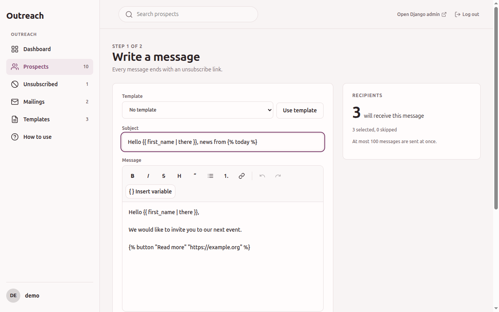
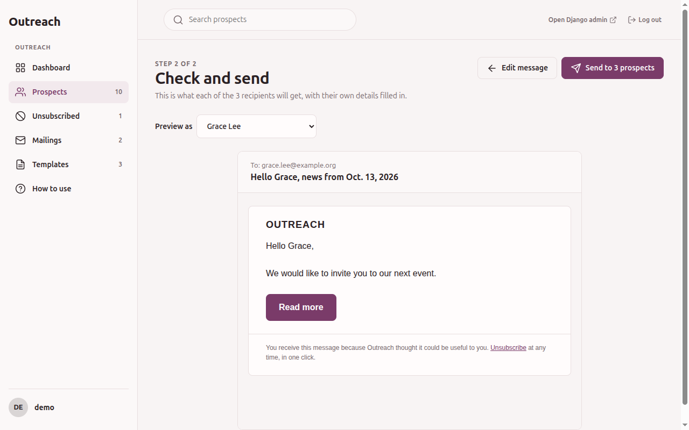

# Sending mail

Mail is sent from the prospect list, in two steps: write, then check and send. You need
`change_prospect`.

## 1. Select and write

1. In *Prospects*, tick the people to mail.
2. Choose *Send a mail to the selected prospects* and press *Go*.
3. The page *Write a message* shows the form on the left and the recipients on the right.

The recipients panel counts who will receive the message and lists who is skipped, and why.

| Skip reason | Why |
|---|---|
| Unsubscribed | The prospect unsubscribed (newsletters only) |
| Suppressed | The address is on the suppression list (newsletters only) |
| Not a member | The prospect is not linked to a user (notices only) |
| Contacted recently | Mailed within the resend cooldown (24 hours by default) |
| Over the send limit | Beyond the maximum for one send (100 by default) |

The dashboard shows the limits of your installation under *Before you send*. If the page says
that sending is disabled, ask your developer to set `OUTREACH_BASE_URL`.

Fill in:

- **Subject**: a single line. Variables and tags work, buttons do not.
- **Header text**: shown at the top of the message. Empty means the site name. A single line, no variables.
- **Newsletter**: ticked by default. See below.
- **Message**: the rich text editor. Allowed formatting is paragraphs, bold, italic, strike
  through, a heading, bullet and numbered lists, quotes and links. Anything else is removed.

The *Insert variable* button in the editor toolbar adds a variable at the cursor.

## Send now or later

When Outreach sends with Celery, the compose page has a *Send at* field. Empty means now. With a
time, the preview button reads *Schedule for N prospects*, and nothing is sent until that time.
The mailing appears in *Mailings* with its scheduled time and the recipients as *scheduled*, and
can be cancelled from its page until it starts. Someone has to run the scheduler for it to start,
see {doc}`../topics/sending-with-celery`.

## Newsletter or notice

| | Newsletter (ticked) | Notice (unticked) |
|---|---|---|
| Unsubscribe link in the footer and `List-Unsubscribe` headers | Yes, added for you | None |
| Who receives it | Anyone who passes the skip rules | Members only |
| Unsubscribed or suppressed members | Skipped | Still receive it |

Use a notice for service messages to members, for example a change to the terms of service. A
notice never changes who is unsubscribed, and its text cannot contain `{{ unsubscribe_url }}`.
The recipients panel follows the type chosen once you apply a template, preview or save.

Both settings can be saved in a template, and a mailing keeps a copy of them.

The host project can add its logo to the header and to the footer of mails with
`OUTREACH_EMAIL_LOGO_IN_HEADER` and `OUTREACH_EMAIL_LOGO_IN_FOOTER`. A logo in the header is
centered. When there is a header logo and no header text, the logo stands alone and the site name
is not repeated as text. A header text is shown under the logo, centered with it.

## Variables

A variable is replaced for each recipient.

| Variable | Value |
|---|---|
| `{{ first_name }}` | First name |
| `{{ last_name }}` | Last name |
| `{{ full_name }}` | First and last name |
| `{{ organization }}` | Organization |
| `{{ email }}` | Email address |
| `{{ city }}` | City |
| `{{ country }}` | Country |
| `{{ unsubscribe_url }}` | The recipient's unsubscribe link |

Add a fallback after a pipe for when the value is empty: `{{ first_name | there }}` writes
"there" for a prospect with no first name. For a member whose own first and last name are empty,
the name of the linked user account is used.

Only these names work. An unknown or malformed one is refused when you preview, with the list of
valid names.

## Computed tags

A tag is a small function run for each recipient, written `` or
``. Its result is plain text. These are built in:

| Tag | Result |
|---|---|
| `` or `` | The send date. The optional text is a Django date format |
| `` | Good morning, afternoon or evening, from the server time at send |
| `` | The date the linked user joined, empty for a prospect with no user |

Your developer may have added more. *How to use* lists every tag with an example. An unknown tag,
too many arguments or a stray `{%` is refused when you preview.

## Buttons

`` writes a link styled as a button, in the accent
colour of the site theme. It takes exactly a label and a link, and only works in the message, not
in the subject.

- The link starts with `http`, `https` or `mailto` and has no space.
- The link can be a variable, for example ``.
- A button can not be placed inside a link.
- In the plain-text version of the mail, a button reads `Label (link)`.
- Outlook for desktop shows a button as a plain coloured link.

## Using a template

If a developer or an administrator gave you template permissions, a *Template* menu sits above the
subject. Choose one and press *Use template* to replace the subject and message. Nothing is sent
and nothing is kept until you go on. *Save this message as a template* below the form stores the
current text under a name, see {doc}`email-templates`.

## 2. Check and send

Press *Preview message*. Step 2 shows the mail exactly as a recipient gets it, with their details
filled in, in a frame cut off from the rest of the page. *Preview as* switches to another
recipient. Computed tags run for real in this preview, except those that declare they have side
effects, which show a placeholder.

- *Edit message* goes back to step 1 with your text.
- *Send to N prospects* sends. There is no second confirmation, and no undo.

When the send finishes, the list shows a line such as *12 sent, 3 skipped, 0 failed*.

## What happens during a send

- Sending runs while you wait. A send takes about a third of a second per mail, which is why the
  number of recipients is capped.
- Before the first mail, the recipients are marked as mailed. If you press the button twice, or
  someone else sends to the same people, the second attempt finds them in the cooldown and skips
  them.
- If a mail fails (the server refuses it, or a tag or button link is invalid for that person), only
  that person is affected. They are counted as failed, their "last mailed" date is restored, and a
  failure event is added to their history, with the reason (refused, server or content) and not
  the error text. Others still receive the mail.
- A prospect who unsubscribed while the send was running is not mailed.
- A successful mail sets a never-mailed prospect to *Contacted* and adds a *Mail sent* event.
- Every send with at least one recipient creates a mailing, see {doc}`mailings`.

If one recipient's failure is something you can fix, such as an empty button link, correct it and
send again to that person only. They are no longer in the cooldown. The mailing page shows why a
recipient failed, and *Retry* is worth trying for *the mail server could not be reached*, not for
*the message could not be built*.
